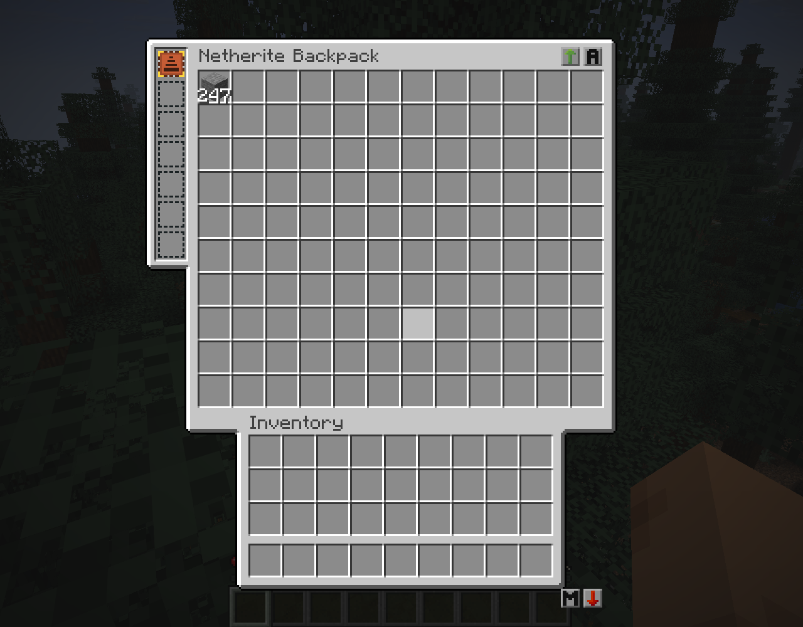

# Backpackery

**Minecraft 26.3 · Fabric Loader 0.20.1 · Java 25**

一个按 **Sophisticated Backpacks / Sophisticated Core** 的界面与规则实现的 Fabric 背包模组：
六级背包、左侧升级槽、可堆叠存储、拾取/磁铁/过滤/虚空/压缩/进食/堆叠升级，
以及精妙背包同款的 9 宫格存储背景、槽位贴图、排序与双向转移按钮。
拾取、磁铁、进食与烹饪升级在背包**放在物品栏里**时就会生效，不必拿在手上。

> 这是独立实现，不是精妙背包的移植或分支。UI 贴图来自 GPLv3 的精妙核心/精妙背包，
> 因此本项目同样以 **GPL-3.0** 发布，署名见 [NOTICE](NOTICE)。



---

## 等级与容量

| 背包 | 存储格 | 布局 | 升级槽 | 每格上限* |
|---|---|---:|---:|---:|
| 皮革背包 | 27 | 9 × 3 | 1 | 64 |
| 铜制背包 | 45 | 9 × 5 | 1 | 64 |
| 铁制背包 | 54 | 9 × 6 | 2 | 64 |
| 金制背包 | 81 | 9 × 9 | 3 | 64 |
| 钻石背包 | 108 | 12 × 9 | 5 | 64 |
| 下界合金背包 | 120 | 12 × 10 | 7 | 64 |

\* 安装堆叠升级后，每格上限 = 64 × 所有堆叠升级倍率之积（最高 64 倍）。
普通物品、工具、药水等仍遵守各自的最大堆叠数。
槽位数字按真实存量显示：例如放入 247 个石头，槽位就显示 **247**，不会被客户端同步容器截成 64。

## 界面一致性

- **9 / 12 列布局**：金及以下 9 列，钻石/下界合金 12 列，面板宽度分别为 176 / 230 px。
- **面板高度** `114 + 行数 × 18`，玩家物品栏和快捷栏落在背景贴图预留的位置。
- **升级槽**在面板左侧的 25 px 竖条内（`x = -15`，每槽 16 px），带空槽虚线框。
- **存储区**使用 `slots_background.png` 的 18 × 18 槽位单元；背景按精妙核心的两段式 9-slice 绘制。
- **排序按钮**在右上角：排序 / 切换排序依据（名称 → 模组 → 数量）。
- **转移按钮**在面板底部右侧：物品栏 → 背包、背包 → 物品栏。
- 全部按钮走 `handleInventoryButtonClick` → `clickMenuButton`，服务端权威执行。
- 界面支持中英文（`en_us` / `zh_cn`），物品提示显示存储格与升级槽数量。

## 升级

| 升级 | 作用 |
|---|---|
| 拾取升级 | 自动拾取 2 格内的掉落物；在物品栏中生效 |
| 高级拾取升级 | 拾取 5 格内的掉落物 |
| 磁铁升级 | 拾取范围扩大到 10 格；在物品栏中生效 |
| 高级磁铁升级 | 拾取范围扩大到 16 格 |
| 过滤升级 | 白名单/黑名单；右键打开过滤界面 |
| 高级过滤升级 | 27 个过滤格 |
| 虚空升级 | 销毁符合自身过滤器的拾取物；右键编辑 |
| 高级虚空升级 | 27 个过滤格的虚空过滤器 |
| 压缩升级 | 拾取时用 2×2 配方压缩（如 4 铁锭 → 铁块） |
| 高级压缩升级 | 拾取时用 3×3 配方压缩（如 9 铁锭 → 铁块） |
| 进食升级 | 饥饿时自动从背包取食；在物品栏中生效 |
| 高级进食升级 | 更高等级的进食升级 |
| 堆叠升级 T1–T4 | 每格上限 ×2 / ×4 / ×8 / ×16，多个升级倍率连乘 |
| 合成 / 切石 / 锻造 / 铁砧升级 | 便携工作站；在背包中右键升级槽打开 |
| 熔炼 / 高炉 / 烟熏升级 | 每秒消耗背包内燃料处理一个物品 |
| 自动熔炼 / 高炉 / 烟熏升级 | 自动处理背包内物品 |

> 当前覆盖：拾取/磁铁/过滤/虚空/压缩/进食/堆叠、四个便携工作站、三种烹饪及自动版，均含高级版本。
> 原版中的唱片机、沉积、补货、补充、工具交换、永恒、无限、嵌套、储罐、电池、泵、经验泵尚未实现；
> 这些需要独立的流体/能量/经验持久化与 GUI，当前版本不会用空壳物品占位。

压缩升级读取服务端配方管理器，因此数据包添加的 2×2 / 3×3 有序配方也会生效；
只有在压缩产物能完整放进背包时才会消耗原料，不会吞物品。

堆叠升级的倍率是**连乘**；拆除升级前会检查现有物品是否还放得下，放不下就拒绝拆除。
单次手动取出上限为 99（原版 `ItemStack` 组件限制），超出部分继续留在背包里。

## 合成

所有升级都以 **升级基座** 为核心，基座配方：

```
线    铁锭   线
铁锭  皮革   铁锭
线    铁锭   线
```

拾取升级与高级拾取升级：

```
      粘性活塞              钻石
线     基座     线      金锭  拾取升级  金锭
红石   红石    红石      红石   红石    红石
```

其余升级按原版图案使用对应的功能方块、红石、末影珍珠、金锭/钻石等；
完整配方（含铁背包的铜升级替代配方、基础磁铁→高级磁铁、熔炼→高炉/烟熏、
自动熔炼→自动高炉/烟熏等 39 个配方）见
`src/main/resources/data/backpackery/recipe/`。

下界合金背包使用 **下界合金升级锻造模板 + 钻石背包 + 下界合金锭** 在锻造台升级。

## 构建

需要 **JDK 25**（Loom 会拒绝 Java 21）：

```powershell
$env:JAVA_HOME="C:\Users\Admin\.jdks\ms-25.0.4.1"
.\gradlew.bat build --offline
```

产物：`build/libs/backpackery-1.0.0.jar`。放入 `mods/` 即可，依赖 Fabric API。

## 自检

服务端执行：

```
/backpackery selftest
```

覆盖数据组件往返、堆叠合并/溢出、过滤白黑名单、磁铁半径、虚空、压缩槽位上限、
GUI 布局数字、菜单注册、Codec 上限等。开发时也可以无头运行：

```powershell
.\gradlew.bat runServer -Pselftest
```

## 许可

GPL-3.0-only。完整文本见 [LICENSE](LICENSE)，第三方贴图署名见 [NOTICE](NOTICE)。

本项目与 P3pp3rF1y、Sophisticated Backpacks、Sophisticated Core 无隶属关系。
